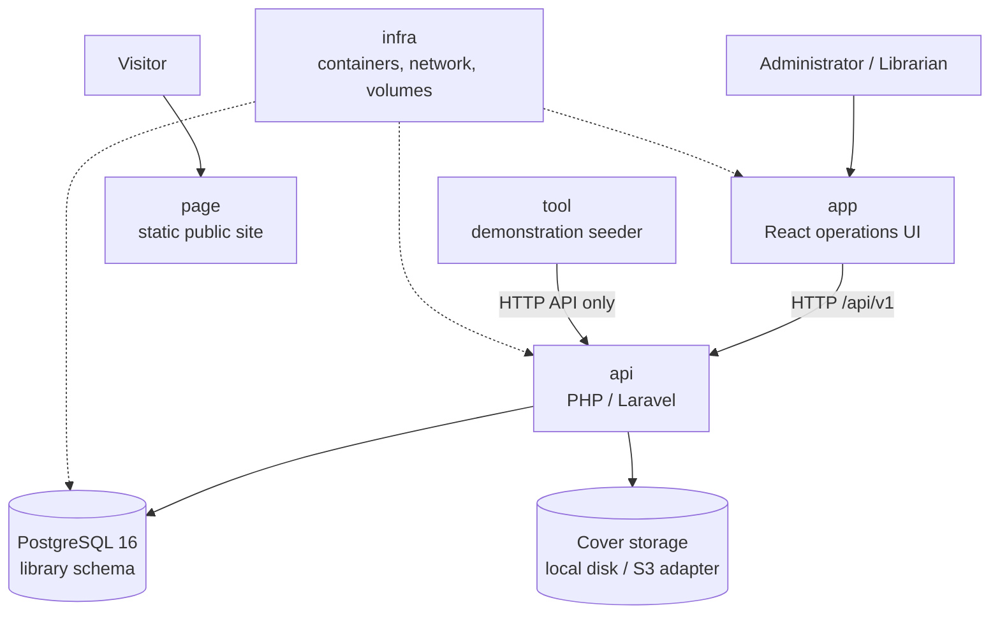

# Architecture Overview — Manager Library

## System context

## Repository boundaries

| Repository | Responsibility | Completion evidence |
|---|---|---|
| `docs` | Canonical specification and decisions | The implementation can be traced to documented requirements |
| `api` | Business rules and HTTP contract | Domain, application, integration, contract, and concurrency tests |
| `app` | Authenticated operational workflows | Login → lend → return → overdue → report walkthrough |
| `page` | Static public presentation | Responsive rendering without the API |
| `infra` | One-command environment and empty database engine | `docker compose up` starts the required services |
| `tool` | Demonstration data through HTTP | Required books, members, loans, overdue items, and report rows |

## Five governing ideas

1. A loan is an immutable fact; only a loan item's `returned_at` changes.
2. Inventory changes and loan-item creation or return happen in the same transaction.
3. Loan status and late days are calculated and never stored.
4. Frozen loan-item values never follow catalog edits.
5. PostgreSQL constraints are the last invariant barrier.
