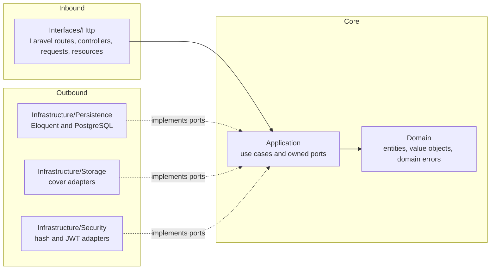
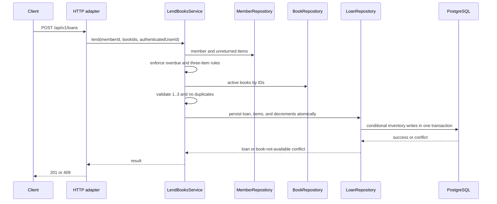

# Architecture — Manager Library (Laravel)

The API uses hexagonal architecture. Dependencies point toward the domain, and Laravel remains at the edges.

## 1. Layers and dependency direction



`AppServiceProvider` is the only component allowed to see both application ports and infrastructure adapters.

## 2. API directory structure

```text
app/
├── Domain/
│   ├── Books/
│   ├── Loans/
│   ├── Members/
│   ├── Users/
│   └── Shared/
├── Application/
│   ├── Ports/
│   └── Services/
├── Infrastructure/
│   ├── Persistence/
│   ├── Security/
│   ├── Storage/
│   └── Time/
├── Interfaces/
│   └── Http/
└── Providers/
    └── AppServiceProvider.php
```

- `Domain` contains plain PHP and no framework dependencies.
- `Application` contains use cases and the ports they consume.
- `Infrastructure` contains Eloquent models, repositories, query readers, hashing, token, clock, and storage adapters.
- `Interfaces/Http` contains controllers, request validation, resources, middleware, and exception translation.
- `routes/api.php` declares routes but contains no business logic.
- `database/migrations` is the only schema owner.

## 3. Aggregates

| Root | Contains | Protected invariants |
|---|---|---|
| `Book` | `Isbn`, total and available copy quantities, logical deletion | `0 <= available <= total`, total at least 1, non-empty title |
| `Loan` | 1 to 3 `LoanItem` values | No duplicate book, 14-day due date, immutable loan facts |
| `Member` | Required document number | Document uniqueness is completed by the repository/database |
| `User` | Normalized username, password hash, role | Lowercase username; `admin` or `librarian` role |

The application service coordinates multiple aggregates and persistence. It does not rely on active-record behavior from domain objects.

## 4. Register-loan flow



Concurrency uses conditional writes over the documented fields and the `ck_book_available_range` database constraint. The schema does not gain a `version` column.

## 5. Error boundary

Domain and application layers raise their own errors such as `BookNotAvailable`, `MemberHasOverdue`, and `MemberLimitExceeded`. Only the HTTP adapter maps them to status codes and the common error body.

Laravel validation, authentication, authorization, routing, and unexpected errors must pass through the same response boundary. Framework exception pages never reach clients.

## 6. Transaction boundaries

- Creating a loan, creating all its items, and decrementing every book are one transaction.
- Returning an item and incrementing its book are one transaction.
- An inventory conflict rolls back the complete operation.
- Cover metadata is committed before an old binary is physically removed.
- Report reads use one aggregate query and do not persist results.

## 7. Deliberate omissions

There are no domain events, queues, caches, microservices, multi-tenancy, sessions, refresh tokens, generic audit records, or additional catalog fields. These are not architecture improvements unless a requirement asks for them.
