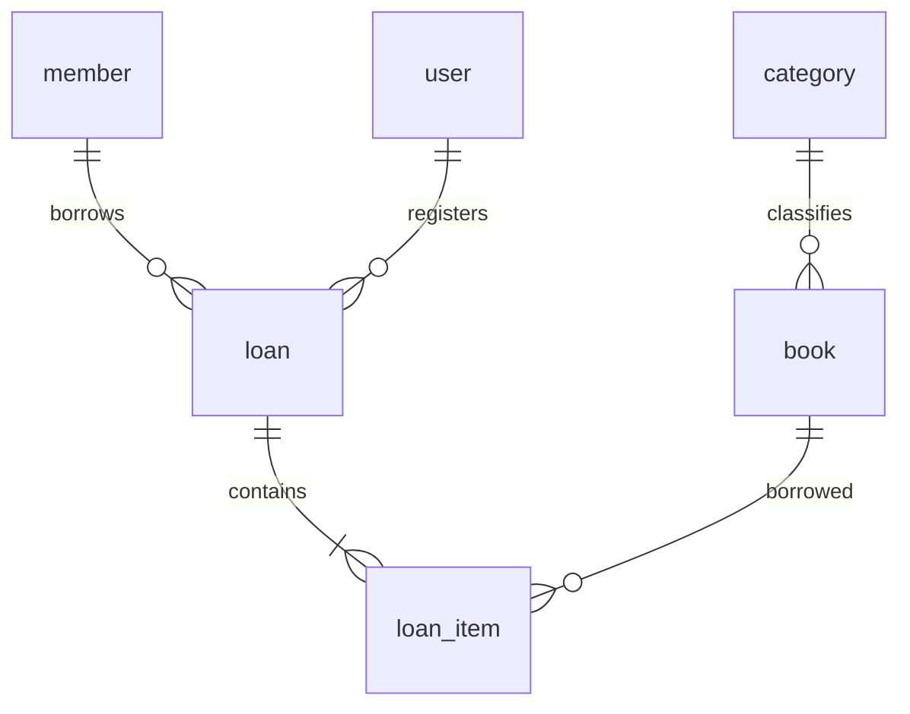

# Data Model — Manager Library

This document is the only authoritative definition of the database model.

- Engine: PostgreSQL 16.
- Schema: `library`.
- Server time zone: UTC.
- Every identifier is a UUID v4 generated by the application.
- No column has a `DEFAULT`; the domain supplies every value.

Each invariant is classified as **engine**, **domain only**, or **pending (T-xx)**.

## 1. Naming conventions

| Element | Convention | Example |
|---|---|---|
| Table | English, singular `snake_case` | `loan_item` |
| Column | English, singular ASCII `snake_case` | `due_at` |
| Named check | `ck_{table}_{rule}` | `ck_book_available_range` |
| Schema | `library` | `library.loan` |

The reserved table name `user` is written as `library."user"` in raw SQL. The persistence adapter must quote it correctly.

## 2. Glossary

| Concept | Definition | Storage |
|---|---|---|
| Book | Catalog title with author, ISBN, category, copy counts, and optional cover | `book` |
| Category | One of five fixed classifications; seeded and not maintained through the API | `category` |
| Copy | A physical copy is counted, not individually identified | `book.total_copies`, `book.available_copies` |
| Member | A borrower that does not log in | `member` |
| Loan | Immutable fact recording the member, operator, and lending instant | `loan` |
| Loan item | One borrowed book with its due and return instants | `loan_item` |
| Loan status | `open`, `overdue`, or `closed`; calculated, never stored | No column |
| User | Internal operator with `admin` or `librarian` role | `user` |
| Frozen value | Value copied at lending time and independent of the live catalog | `loan_item.book_title`, `isbn`, `category_name` |

## 3. Relationships



There are exactly six tables. There is no copy, report, fine, payment, reservation, or audit table.

## 4. Physical model

### `category`

Read-only seed table.

| Column | PostgreSQL type | Nullable | Rule |
|---|---|---|---|
| `id` | `uuid` | no | Primary key; fixed identifiers from section 10 |
| `name` | `varchar(120)` | no | Unique |

### `book`

| Column | PostgreSQL type | Nullable | Rule |
|---|---|---|---|
| `id` | `uuid` | no | Primary key |
| `title` | `varchar(250)` | no | Trimmed by the domain |
| `author` | `varchar(200)` | no | Author name |
| `isbn` | `char(13)` | no | Digits only; unique among active books |
| `category_id` | `uuid` | no | Restrictive FK to `category.id` |
| `total_copies` | `integer` | no | At least 1 |
| `available_copies` | `integer` | no | Between 0 and `total_copies` |
| `cover_key` | `varchar(512)` | yes | Opaque key; never a path, bytes, or empty string |
| `deleted_at` | `timestamptz` | yes | Logical deletion instant; `null` means active |

No `version` column exists. Concurrency behavior must not introduce one without an approved schema change.

### `member`

| Column | PostgreSQL type | Nullable | Rule |
|---|---|---|---|
| `id` | `uuid` | no | Primary key |
| `full_name` | `varchar(200)` | no | Member name |
| `document_number` | `varchar(30)` | no | Unique |

### `loan`

| Column | PostgreSQL type | Nullable | Rule |
|---|---|---|---|
| `id` | `uuid` | no | Primary key |
| `member_id` | `uuid` | no | Restrictive FK to `member.id` |
| `loaned_by_user_id` | `uuid` | no | Restrictive FK to `user.id` |
| `loaned_at` | `timestamptz` | no | Lending instant |

### `loan_item`

| Column | PostgreSQL type | Nullable | Rule |
|---|---|---|---|
| `id` | `uuid` | no | Primary key |
| `loan_id` | `uuid` | no | FK to `loan.id` with `ON DELETE CASCADE` |
| `book_id` | `uuid` | no | Restrictive FK to `book.id` |
| `book_title` | `varchar(250)` | no | Frozen; same length as `book.title` |
| `isbn` | `char(13)` | no | Frozen |
| `category_name` | `varchar(120)` | no | Frozen; deliberately has no FK |
| `due_at` | `timestamptz` | no | `loaned_at + 14 days`, calculated by the domain |
| `returned_at` | `timestamptz` | yes | `null` until returned |

### `user`

| Column | PostgreSQL type | Nullable | Rule |
|---|---|---|---|
| `id` | `uuid` | no | Primary key |
| `username` | `varchar(120)` | no | Unique, trimmed, and lowercased |
| `password_hash` | `varchar(512)` | no | Never indexed or returned |
| `role` | `varchar(40)` | no | `admin` or `librarian` |

Every timestamp uses `timestamptz`. There are no `created_at`, `updated_at`, `status`, or `days_late` columns.

## 5. Constraints and indexes

| Invariant | Database object | Classification |
|---|---|---|
| Primary keys for all six tables | Primary keys | **engine** |
| Unique category name | Unique index | **engine** |
| Unique member document | Unique index | **engine** |
| Unique username | Unique index | **engine** |
| Unique ISBN among active books | Partial unique index where `deleted_at IS NULL` | **engine** |
| `book.category_id` references `category.id` | Foreign key | **engine** |
| `loan.member_id` references `member.id` | Foreign key | **engine** |
| `loan.loaned_by_user_id` references `user.id` | Foreign key | **engine** |
| `loan_item.loan_id` references `loan.id` | Foreign key | **engine** |
| `loan_item.book_id` references `book.id` | Foreign key | **engine** |
| `0 <= available_copies <= total_copies` | `ck_book_available_range` | **engine** |
| `total_copies >= 1` | `ck_book_total_positive` | **pending (T-18)**; initially domain only |
| Unique `(loan_id, book_id)` | Unique index | **engine** |
| `role IN ('admin', 'librarian')` | `ck_user_role` | **pending (T-18)**; initially domain only |
| At most 3 unreturned items per member | Application rule | **domain only** |
| A member with overdue items cannot borrow | Application rule | **domain only** |
| Decrement copies and create loan items atomically | Transaction | **domain only** |
| A loan contains 1 to 3 items | Domain invariant | **domain only** |
| Loans are immutable except for item return | Absence of mutation operations | **domain only** |

Required access indexes:

- Partial `book (category_id, title)` for active books.
- `loan (loaned_at)`.
- `loan_item (book_id)`.
- Partial `loan_item (due_at)` where `returned_at IS NULL`.

## 6. Foreign-key policy

| FK | `ON DELETE` | Reason |
|---|---|---|
| `book.category_id` | `RESTRICT` | Categories with books cannot disappear |
| `loan_item.loan_id` | `CASCADE` | An item belongs to its loan; loans have no delete operation |
| `loan_item.book_id` | `RESTRICT` | Manual deletion cannot orphan history |
| `loan.member_id` | `RESTRICT` | Loan ownership is retained |
| `loan.loaned_by_user_id` | `RESTRICT` | The registering operator is retained |

Every foreign key uses `ON UPDATE NO ACTION`; application-generated UUIDs never change.

## 7. Access patterns

| ID | Pattern | Frequency |
|---|---|---|
| Q1 | Search active books by text and category, ordered and paginated | High |
| Q2 | Find active book by ID | High |
| Q3 | Fetch books by an ID batch before lending | High; contention point |
| Q4 | List categories | High |
| Q5 | Fetch a loan with its items | Medium |
| Q6 | List loans by date range, calculated status, and member | High |
| Q7 | Count and inspect a member's unreturned items | High; every loan |
| Q8 | List overdue items globally | Medium |
| Q9 | Aggregate the most-borrowed report | High; most expensive |
| Q10 | Find user by username | High; every login |

## 8. Privacy and retention

| Table | Data | Classification and handling |
|---|---|---|
| `user` | `username` | Personal data; restricted access |
| `user` | `password_hash` | Secret; never logged, returned, or indexed |
| `member` | `full_name`, `document_number` | Personal data; only `admin` and `librarian` |
| `loan`, `loan_item` | All fields | Indefinite retention; `member_id` is indirect personal data |
| `book`, `category` | All fields | Public classification; catalog access still follows API authentication rules |

Reports never expose members or librarians. Loans and items are never deleted; books use logical deletion. Cover binary data is the only physically deleted product data. The application first commits `cover_key = null` and only then deletes the binary.

## 9. Audit policy

The product does not provide generic audit history. Business instants are represented only by `loan.loaned_at`, `loan_item.returned_at`, and `book.deleted_at`.

## 10. Fixed category seed

The initial migration inserts exactly these rows:

| `id` | `name` |
|---|---|
| `11111111-1111-4111-8111-111111111111` | `Novela` |
| `22222222-2222-4222-8222-222222222222` | `Ciencia` |
| `33333333-3333-4333-8333-333333333333` | `Tecnología` |
| `44444444-4444-4444-8444-444444444444` | `Historia` |
| `55555555-5555-4555-8555-555555555555` | `Infantil` |

The database does not seed the initial administrator. Application startup creates it from `ADMIN_USERNAME` and `ADMIN_PASSWORD` through the password hasher port. The demonstration tool uses the API and never SQL.

## 11. Executable schema verification

```sql
SELECT table_name, ordinal_position, column_name, data_type, is_nullable, column_default
FROM information_schema.columns
WHERE table_schema = 'library'
ORDER BY 1, 2;

SELECT c.conrelid::regclass, c.conname, c.contype, pg_get_constraintdef(c.oid)
FROM pg_constraint c
JOIN pg_namespace n ON n.oid = c.connamespace
WHERE n.nspname = 'library'
ORDER BY 1, 3, 2;

SELECT tablename, indexname, indexdef
FROM pg_indexes
WHERE schemaname = 'library'
ORDER BY 1, 2;
```

The first query must report exactly the columns in section 4 and no defaults. A missing **engine** rule is a defect. If an implementation adds a database constraint for a **domain only** rule, this document must be explicitly reviewed rather than silently changed.
